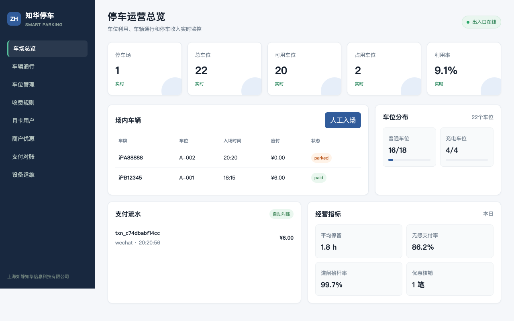
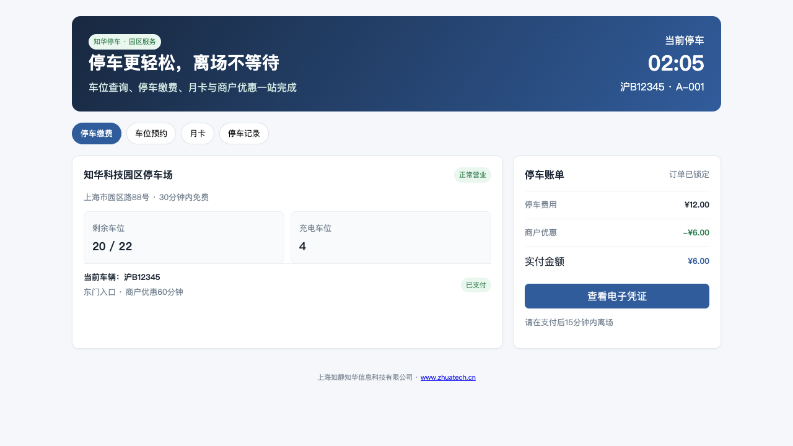

# ZhuaTech Smart Parking｜知华智慧停车

面向产业园区、写字楼、商业综合体与物业公司的智慧停车社区源码项目。系统围绕“车辆真正完成一次停车”设计，而不是只展示车位数量：从车牌入场、预约核销、车位分配到计费、优惠、支付和道闸离场均有可执行规则。

维护方：[知华科技（上海如静知华信息科技有限公司）](https://www.zhuatech.cn/)

商业授权、车牌识别/道闸对接或定制开发：微信 `zhuatech`、`zhuatech2`。

## 两个使用视角





### 车主的一次停车旅程

1. 入场接口通过幂等键避免识别结果重复落单；
2. 系统检查黑名单、重复入场和剩余车位；
3. 有效预约优先核销，否则自动分配可用车位；
4. 费用按照免费时长、小时费率和每日封顶计算；
5. 月卡自动免单，商户优惠支持减免分钟或固定金额；
6. 支付完成后进入离场宽限期，离场成功释放车位。

## 能力清单

- **车场资源**：多停车场、普通/充电/无障碍车位、批量建位、状态占用；
- **车辆通行**：入场、离场、道闸来源、重复识别幂等、黑名单拦截；
- **预约停车**：按车型预约、车位锁定、过期释放、入场自动核销；
- **收费引擎**：免费时长、向上取整、跨日封顶、支付后离场宽限；
- **月卡业务**：车牌绑定、有效期校验、免费通行及完整通行记录；
- **商户优惠**：分钟券、金额券、有效期、单次核销；
- **支付对账**：微信/支付宝等渠道标识、交易号、幂等支付、收入汇总；
- **经营分析**：利用率、剩余车位、在场车辆、收入和通行流水。

## 本地运行

```bash
cp .env.example .env
npm test
PARKING_API_KEY=zhuatech-demo-key npm start
```

运营端访问 `http://127.0.0.1:18102/`，车主端访问 `http://127.0.0.1:18102/driver`。也可以执行 `docker compose up --build`。

## 技术设计

系统采用零依赖 Node.js 领域服务，运行数据默认保存到 `data/parking.json`；`database/schema.sql` 给出了 MySQL 8 表结构。HTTP API 和车牌识别、道闸、支付平台之间通过明确边界集成，详见 [API](docs/API.md) 与 [架构](docs/ARCHITECTURE.md)。

```text
车牌相机/道闸 ─→ 通行API ─→ 停车领域服务 ─→ JSON / MySQL
车主H5 ───────→ 计费/支付 ─────┘        └→ 审计与经营指标
```

## 测试覆盖

自动化用例覆盖临停完整闭环、月卡免单、优惠券核销、幂等入场、黑名单和满位拒绝。示例数据仅用于演示，不应直接连接真实支付账户或生产道闸。

## 社区许可边界

代码仅供个人非商业学习、研究和交流，不得用于企业生产、SaaS、商业项目、投标或收费交付；商业使用需要上海如静知华信息科技有限公司书面授权。该许可带有非商业限制，因此项目是 source-available 社区源码，而非 OSI 认可的开源软件。

| 微信咨询 `zhuatech` | 微信咨询 `zhuatech2` |
| --- | --- |
|  |  |

Copyright © 上海如静知华信息科技有限公司。
